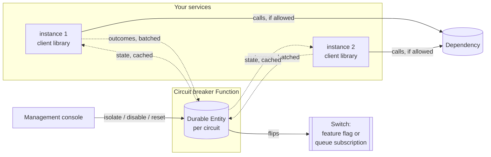

# Circuit breakers on Azure Functions — a working playbook

A circuit breaker that is shared by every instance of every service that calls a dependency,
survives restarts, and can be watched and overruled by operators. Built on Azure Functions with
Durable Entities, with a .NET client library and a small management console — and documentation that
explains each design decision and how to apply it to your own solution.



## Why not an in-process breaker?

A breaker inside each process (Polly, `Microsoft.Extensions.Http.Resilience`) is the right default.
It falls short when:

- **many instances call the same dependency.** Each learns about the outage on its own, and they all
  probe the recovering dependency at the same time;
- **state must survive restarts and deployments.** A fresh instance starts closed and hits the
  failing dependency again;
- **work does not go through a call you control.** A queue consumer or a scheduled job should stop
  pulling work while the dependency is down, not fail every item;
- **people need to see and overrule it.** "Is the breaker for the payment provider open, since when,
  and why?" — and "keep it shut until the vendor confirms the fix."

This playbook covers those cases. Combine it with a local breaker where both apply; see
[timeouts and retries](docs/timeouts-and-retries.md).

## What it shows

| Topic | Read | See it in code |
|---|---|---|
| Explicit state machine: `Closed`, `Open`, `HalfOpen` and two manual overrides | [state-machine.md](docs/state-machine.md) | [CircuitTransitions.cs](src/CircuitBreaker.Core/CircuitTransitions.cs) |
| How many failures in which time window open the circuit | [failure-threshold.md](docs/failure-threshold.md) | [FailureWindow.cs](src/CircuitBreaker.Core/FailureWindow.cs) |
| State, counters and timestamps in a Durable Entity | [durable-state.md](docs/durable-state.md) | [CircuitEntity.cs](src/CircuitBreaker.Function/Entities/CircuitEntity.cs) |
| Atomic transitions, no race conditions | [concurrency.md](docs/concurrency.md) | [ReplayAndConcurrencyTests.cs](tests/CircuitBreaker.Function.Tests/ReplayAndConcurrencyTests.cs) |
| How long the circuit stays open | [recovery-timeout.md](docs/recovery-timeout.md) | [Backoff.cs](src/CircuitBreaker.Core/Backoff.cs) |
| A limited number of probe calls while recovering | [half-open-probes.md](docs/half-open-probes.md) | [CircuitEngine.cs](src/CircuitBreaker.Core/CircuitEngine.cs) |
| Which failures count: timeouts, exceptions, functional errors | [failure-classification.md](docs/failure-classification.md) | [Classification.cs](src/CircuitBreaker.Client/Classification.cs) |
| Refusing at once, without touching the dependency | [fail-fast.md](docs/fail-fast.md) | [CircuitBreakerGate.cs](src/CircuitBreaker.Client/CircuitBreakerGate.cs) |
| Timeouts and retries that work with the breaker | [timeouts-and-retries.md](docs/timeouts-and-retries.md) | [ReportingTests.cs](tests/CircuitBreaker.Client.Tests/ReportingTests.cs) |
| Logging, metrics, and testing recovery, crashes, concurrency and replay | [observability-and-testing.md](docs/observability-and-testing.md) | [EntityHarness.cs](tests/CircuitBreaker.Function.Tests/EntityHarness.cs) |
| Stopping queue consumers and scheduled jobs | [switches.md](docs/switches.md) | [CircuitSwitches.cs](src/CircuitBreaker.Function/Switches/CircuitSwitches.cs) |
| Watching and overruling circuits | [management-ui.md](docs/management-ui.md) | [ui/](ui) |

Then: [apply it to your own solution](docs/applying-to-your-solution.md), deploy it with
[security and deployment](docs/security-and-deployment.md), run it with the
[operations guide](docs/operations.md), and read the [pitfalls](docs/pitfalls.md) first.

## Quick start

Requires the .NET 10 SDK and Node.js 24.

```shell
dotnet test CircuitBreaker.slnx
cd ui && npm ci && npm test && npm run dev:mock
```

`dev:mock` opens the management console on demo data. To run the real thing locally — Azurite,
the Function and the console together — follow [getting started](docs/getting-started.md).

## Layout

```text
src/
  CircuitBreaker.Contracts/   What the Function, the client and the UI exchange
  CircuitBreaker.Core/        The rules: state machine, failure window, backoff, probes. Pure, no Azure
  CircuitBreaker.Function/    Durable Entity per circuit, HTTP API, switches, authorization, metrics
  CircuitBreaker.Client/      For callers: the gate, outcome reporting, registration, HttpClient handler
ui/                           Management console (React, TypeScript, Vite)
infra/                        Bicep: Flex Consumption, identity-based storage, Entra ID authentication
tests/
  CircuitBreaker.Core.Tests/      Every rule, including a 5,000-step random walk through the state machine
  CircuitBreaker.Function.Tests/  The entity under a simulated runtime: crashes, duplicate timers, concurrency
  CircuitBreaker.Client.Tests/    Fail-fast, classification, batching, retries outside the breaker
```

## License

[MIT](LICENSE)
