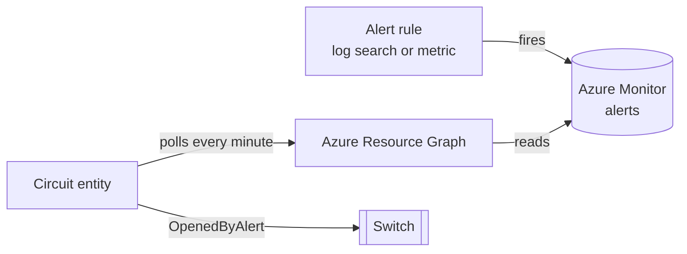

# Alert-driven opening

Outcome counting sees what the caller sees: timeouts, exceptions, 5xx. Some failures never show up
there. The dependency answers `200 OK` but returns wrong data; a downstream system rejects the
records you sent an hour ago; a queue on the other side fills up. You usually already have an
Azure Monitor alert rule for those. Alert-driven opening lets such a rule hold a circuit open, so
the work that makes it worse stops while people fix the cause.

Code: [Alerts.cs](../src/CircuitBreaker.Core/Alerts.cs) (pure rules),
[CircuitEngine.cs](../src/CircuitBreaker.Core/CircuitEngine.cs) (`ApplyAlertPoll`),
[CircuitEntity.cs](../src/CircuitBreaker.Function/Entities/CircuitEntity.cs) (the poll loop),
[ResourceGraphAlertRuleClient.cs](../src/CircuitBreaker.Function/Alerts/ResourceGraphAlertRuleClient.cs).
Tests: [AlertDrivenOpeningTests.cs](../tests/CircuitBreaker.Core.Tests/AlertDrivenOpeningTests.cs),
[AlertPollingTests.cs](../tests/CircuitBreaker.Function.Tests/AlertPollingTests.cs).

## How it works

1. A circuit links up to 20 alert rules by resource id, in its definition (`AlertRuleIds`). The
   caller registers them on start-up like the rest of the definition, so the rule ids have one
   source of truth: put them in an app setting from the Bicep output that created the rules.
2. When a circuit with linked rules is registered, its entity starts a poll loop: a durable signal
   to itself every `AlertPolling:Interval` (default one minute, with ±20% jitter).
3. Each poll asks Azure Resource Graph, in one query, for the linked rules and their alerts that
   are `Fired` and not `Closed`.
4. A rule counts only when it is **suitable**: a log search or metric alert rule that resolves its
   alerts automatically (`autoMitigate`) and is enabled.
5. The result moves the circuit:

| Circuit | A suitable rule fires | No suitable rule fires |
|---|---|---|
| `Closed`, `Open`, `HalfOpen` | → `OpenedByAlert` | nothing changes |
| `OpenedByAlert` | nothing changes | → `OpenedAfterAlert` |
| `OpenedAfterAlert` | → `OpenedByAlert` | nothing changes: a person resets it |
| `Isolated`, `Disabled` | nothing changes: a person decided | nothing changes |

Both alert states open the [switch](switches.md) and refuse calls in the client, like `Open`. See
[state-machine.md](state-machine.md) for why `OpenedByAlert` has no `Reset` and `OpenedAfterAlert`
does not close by itself.

## Design decisions

### Pull, not push

An action group with a webhook would be faster, but it needs an endpoint Azure Monitor can reach,
a way to authenticate it, and a plan for lost or out-of-order calls. The breaker pulls instead:

- it works when the Function only has a private endpoint;
- it is **level-triggered**: every poll reads the current truth, so a missed poll costs one
  interval, never a stuck circuit;
- applying the same result twice changes nothing, so duplicate or late poll signals are harmless.

### A failed poll changes nothing

When Resource Graph times out, throttles or refuses, the circuit keeps its state. Opening on a
failed poll would let a monitoring hiccup stop production; closing would release work the alert
still holds. The error is shown in the circuit (`alerts.lastError`), logged as event 1011, counted
in `circuitbreaker.alert_polls`, and becomes a [health](observability-and-testing.md#health)
reason after five intervals without a successful poll.

### A mode, not a feature flag

`AlertPolling:Mode` is `Off`, `Shadow` or `Active`, set as an app setting on the breaker:

| Mode | Polls | Changes state |
|---|---|---|
| `Off` | no | no; a circuit held by an alert is handed over to a person (`OpenedAfterAlert`) |
| `Shadow` | yes | no; the circuit shows "would open" (`alerts.wouldOpen`) |
| `Active` | yes | yes |

It is a deployment setting rather than a feature flag in the store the breaker writes to, so the
breaker cannot switch its own behaviour by accident, and a change is visible in the deployment
history. The mode is read at every poll; circuits pick up a change within one interval.

### Measure upstream, switch downstream

A rule that measures the work the circuit stops resolves as soon as the circuit opens — no work, no
errors — and the circuit flaps. Let the rule measure the symptom at the dependency or the receiving
side, and let the circuit stop the work that feeds it. The `OpenedAfterAlert` state breaks any
remaining loop: after the alert resolves, nothing restarts until a person says so.

## What Azure does, and what that means

| Fact | Consequence |
|---|---|
| A log search rule fires 2–8 minutes after the symptom, and resolves 20–26 minutes after it ends | alert-driven opening is for problems that last; outcome counting stays the fast path |
| Resource Graph shows a change to an alert after about 45 seconds, and can briefly show an older value | one poll can disagree with the portal; the next one catches up |
| Closing an alert in the portal sets `alertState` to `Closed` but leaves `monitorCondition` at `Fired` | the query requires both `Fired` and not `Closed`, so closing an alert releases the circuit |
| Resource Graph throttles at about 15 queries per 5 seconds per identity | keep the jitter; with many circuits, raise the interval |
| Resource Graph silently omits resources the identity may not read | a rule without read access looks exactly like a deleted one: `NotFound` |
| A role assignment can take more than 9 minutes to take effect for Resource Graph | expect `NotFound` right after the first deployment; that is why the rollout starts in `Shadow` |
| A stateless rule (no `autoMitigate`) never resolves its alerts | it would hold a circuit open forever, so the breaker ignores it (`Stateless`) |
| Activity log, smart detection and other rule types do not resolve on their own | ignored (`UnsupportedType`) |
| Disabling a rule is a deliberate act | it counts as resolved (`Disabled`): a valid way to release a circuit |

## Permissions

The breaker's managed identity needs **Monitoring Reader** on the resource groups that hold the
linked rules. Pass them as `alertRuleResourceGroups` to [main.bicep](../infra/main.bicep); for
another subscription, deploy [monitoring-reader.bicep](../infra/modules/monitoring-reader.bicep)
there. Mind that:

- a `CanNotDelete` lock on the resource group also blocks removing the role assignment later;
- a deployment slot has its own identity and needs its own assignment;
- for log search rules, give Monitoring Reader on the Log Analytics workspace as well when the
  alert instances are not visible: in some setups they are scoped to the workspace.

## Writing a rule that may drive a circuit

- **Stateful:** "Automatically resolve alerts" on. Otherwise it is ignored.
- **Specific:** one symptom, one rule. A rule that fires for unrelated reasons stops unrelated work.
- **Described for the person on call.** The alert description is the first thing they read. Name
  the circuits it drives, what stops while they are open, and link the runbook below.

## Runbook: a circuit is opened by an alert

1. In the console, open the circuit: **Tripped by** names the rule.
2. Fix the cause. The circuit holds the work back meanwhile.
3. Repair the data the stopped work depends on, if needed.
4. Close the alert in Azure Monitor (or wait until it resolves).
5. Press **Check alerts now** instead of waiting for the next poll. The circuit moves to
   `OpenedAfterAlert`.
6. **Reset** with a reason. Work resumes.

**Emergency release while the alert still fires:** `Disable` the circuit. Work flows and the alert
is ignored until someone resets the circuit — at which point the alert takes over again.

`POST /api/circuits/{key}/alert-checks` (Operator) runs a poll right away and returns the new
snapshot; with `202` the poll is still running. It does not start a second poll loop.

## Rolling it out

The two states are new values in contracts and stored state. A client or console that does not know
them cannot read a snapshot that contains them: the client then treats the breaker as unreachable
and, by default, lets calls through. So introduce them in this order:

1. **Release with `Mode = Off`.** The breaker, every client and the console learn the new states.
   Nothing produces them yet.
2. **Redeploy every caller and the console**, so no old reader is left.
3. **`Shadow`.** Link rules, watch `wouldOpen` and the rule suitability in the console for a while.
   Fix rules that are `NotFound` (permissions) or `Stateless`.
4. **`Active`.**

To roll back: set `Mode = Off` first, reset every circuit in `OpenedAfterAlert` (a person checks
each), and only then deploy the older version. Turning polling on again later needs no action:
registration restarts each circuit's poll loop.

## Health

A circuit with linked rules reports why alert-driven opening might not work: a poller without a
successful poll for five intervals (101), a rule that is not found (102), stateless (103), or of an
unsupported type (104). These make the circuit **Degraded**, never Unhealthy: the circuit still
works on outcomes. See [observability-and-testing.md](observability-and-testing.md#health).

## Not for parameterized circuits

One alert rule says "something is wrong", not "something is wrong for partner 42". Do not link
rules to [per-key circuits](switches.md#per-key-circuits-one-partner-at-a-time); link them to the
circuit that stops the shared work.
