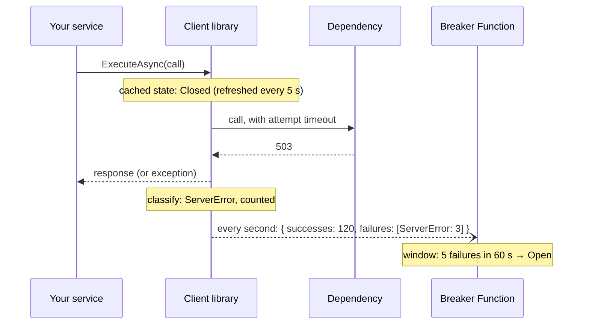

# Architecture

Four parts, each with one job.

| Part | Job | Runs |
|---|---|---|
| [CircuitBreaker.Core](../src/CircuitBreaker.Core) | Decides. All rules as pure functions of state, input and time. | everywhere it is referenced |
| [CircuitBreaker.Function](../src/CircuitBreaker.Function) | Remembers and coordinates. One Durable Entity per circuit; HTTP API; switches. | Azure Functions |
| [CircuitBreaker.Client](../src/CircuitBreaker.Client) | Guards calls. Decides locally from a cached state; reports outcomes in batches. | inside each calling service |
| [ui](../ui) | Shows and overrules. Lists circuits, history, failing switches; isolate, disable, reset. | any static host |

## Control plane and data plane

The central idea: **the breaker is not on the request path.**

- The **data plane** is your service calling its dependency. The client library decides there and
  then, from a copy of the circuit's state it refreshes every few seconds. A closed circuit adds no
  network call to a request; an open one refuses at once.
- The **control plane** is the Function. It receives outcomes in batches, decides transitions, and
  publishes state. It is only consulted synchronously in one case: to hand out a probe permit while
  half-open, when calls are rare anyway.

A breaker that every call has to ask would add latency to every request and become a single point
of failure for everything it protects. This one degrades gracefully: if the Function is unreachable,
callers keep using the last known state, and with no state at all they let calls through (configurable).

## Flows

### A call while closed



### Recovery

```mermaid
sequenceDiagram
    participant C as Client library
    participant F as Breaker Function
    participant E as Circuit entity
    participant D as Dependency
    Note over E: Open; durable timer at recoveryAt
    E->>E: RecoveryTimeoutElapsed(generation 7) → HalfOpen
    C->>F: POST /probes
    F->>E: TryAcquireProbe (atomic)
    E-->>F: permit, probe id, lease 30 s
    F-->>C: granted
    C->>D: probe call
    D-->>C: 200
    C--)F: probeResults: [{ id, succeeded }]
    F--)E: ReportOutcomes → enough successes → Closed
```

## Why Durable Entities

A circuit's state must be shared by all callers, changed atomically, survive restarts, and wake up
by itself when the recovery timeout elapses. Durable Entities give all four with no extra
infrastructure:

| Need | How the entity provides it |
|---|---|
| shared | one entity per circuit key, addressed by every caller |
| atomic | the runtime runs an entity's operations one at a time |
| durable | state is persisted in the task hub after every batch of operations |
| wakes up by itself | an entity can signal itself at a future time — a durable timer |

The alternatives each miss one: a database row needs optimistic concurrency and a scheduler; a
cache loses state; a singleton service is a single point of failure. See
[durable-state.md](durable-state.md) and [concurrency.md](concurrency.md).

## Why the rules live outside the entity

[CircuitEngine.cs](../src/CircuitBreaker.Core/CircuitEngine.cs) takes the state, the input and "now",
changes the state, and returns *effects*: signals to schedule, transitions to log. The entity supplies
the time, carries out the effects and flips the switch. Consequences:

- every rule is tested in microseconds, without a runtime ([CircuitBreaker.Core.Tests](../tests/CircuitBreaker.Core.Tests));
- the entity is a thin adapter of about 200 lines;
- the same engine could run on another host (a database row with a lock, an actor framework) unchanged.

## The HTTP API

| Method and route | Role | Purpose |
|---|---|---|
| `PUT /api/circuits/{key}` | Reporter | Register or update a circuit definition |
| `POST /api/circuits/{key}/outcomes` | Reporter | Report a batch of outcomes (signal, returns 202) |
| `POST /api/circuits/{key}/probes` | Reporter | Request a probe permit (waits for the entity's answer) |
| `GET /api/circuits/{key}` | Reporter, Reader, Operator | Read one circuit |
| `GET /api/circuits` | Reader, Operator | Read all circuits |
| `POST /api/circuits/{key}/actions/{isolate\|disable\|reset\|delete}` | Operator | Manual action, with a required reason |
| `GET /api/me` | any | The caller's name and roles, for the console |

Roles and authentication: [security-and-deployment.md](security-and-deployment.md).
