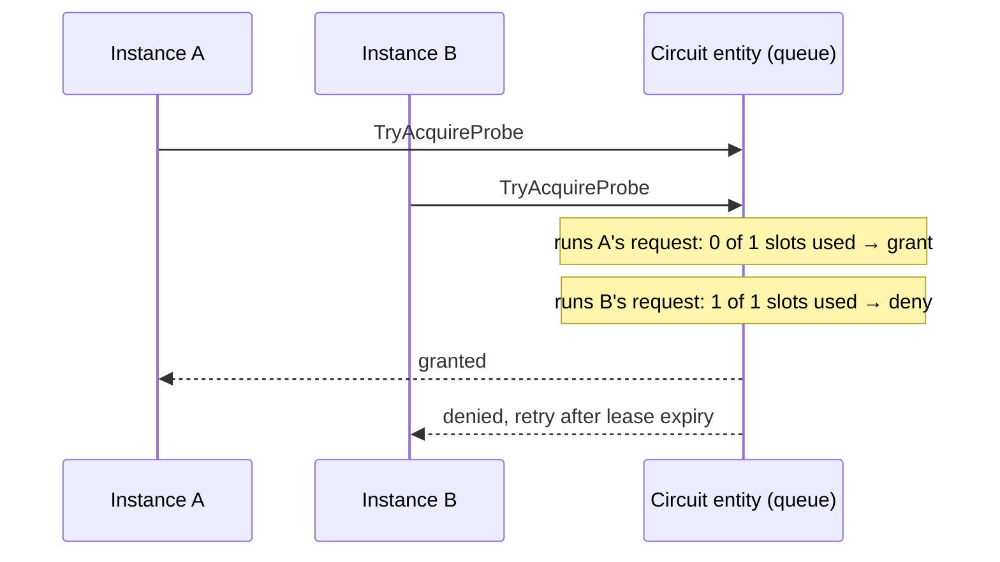

# Concurrency

Hundreds of instances report outcomes, request probes and read state at the same time; timers fire;
an operator acts. Every state change must still be atomic and every rule must hold.

## One operation at a time, per circuit

The Durable Functions runtime runs the operations of one entity strictly one after another. Each
operation sees the state left by the previous one and changes it without interference. There are no
locks in the code, no compare-and-swap, no retries on conflict — and no race conditions to have.

Different circuits are different entities and run in parallel.

## Writes that need an answer, and writes that do not

| Operation | How it reaches the entity | Why |
|---|---|---|
| report outcomes, register | **signal**: queued, the HTTP request returns 202 at once | the caller does not need to wait |
| request a probe, manual action | **call** via a one-step orchestration, the HTTP request waits for the answer | the caller needs to know: permit or not, accepted or not |

A Durable client can signal an entity but not call it; an orchestration can. The two orchestrations
in [CircuitOrchestrations.cs](../src/CircuitBreaker.Function/Orchestrations/CircuitOrchestrations.cs)
do nothing but call the entity and return its answer. They only run while half-open or when an
operator acts, so their latency (tens to hundreds of milliseconds) does not matter. If the answer
takes longer than `ProbeWaitTimeout` (5 s), the probe is denied; a permit granted too late is never
used and its lease simply expires.

## Throughput: batch, don't stream

An entity handles operations one at a time, so its throughput is limited — hundreds of operations per
second, not tens of thousands. The client therefore never sends one request per call:
[OutcomeReporter.cs](../src/CircuitBreaker.Client/OutcomeReporter.cs) aggregates outcomes per circuit
and sends one report per second per instance. Fifty instances at any call volume mean fifty
operations per second, well within budget.

Batching is valid because the [failure window](failure-threshold.md) counts failures regardless of
their order. The test `An_aggregated_report_counts_the_same_as_individual_reports` proves it.

## Stale and duplicate signals

Signals can be delivered twice, and timers can fire after the situation changed:

- the circuit opened (timer A at 10:00:30), an operator reset it, it opened again (timer B at 10:01:10)
  — timer A must not end the second opening early;
- a probe lease expired, but its result arrives a moment later;
- a recovery timer is delivered twice.

Every scheduled signal carries a token, and the entity ignores signals whose token no longer matches:

| Signal | Token | Ignored when |
|---|---|---|
| `RecoveryTimeoutElapsed` | generation | the circuit made any transition since |
| `ProbeLeaseExpired` | probe id + generation | the probe completed, or the generation moved on |
| probe result | probe id | the lease is gone (expired or from an earlier half-open period) |
| `ReconcileSwitch`, `CheckStaleness` | due time | a newer retry or check was scheduled since |

The *generation* increments on every transition, so it identifies "this particular stay in this
state". It is also in every snapshot, so the console can tell an old answer from a new one.

## Re-execution after a crash

Entities are not replayed like orchestrations, but they are re-executed: if the host crashes after
running operations but before persisting the result, the runtime runs those operations again from the
last checkpoint. Side effects that already happened — flipping a switch — happen again. So:

- **everything an operation does outside its state must be idempotent.** Switches read the current
  value and only write when it differs ([CircuitSwitches.cs](../src/CircuitBreaker.Function/Switches/CircuitSwitches.cs));
- **decisions must be deterministic given the input and the time.** The engine has no randomness:
  even the backoff jitter is a hash of the circuit key and generation.

## How it is tested

[ReplayAndConcurrencyTests.cs](../tests/CircuitBreaker.Function.Tests/ReplayAndConcurrencyTests.cs),
with a harness that simulates the runtime's guarantees:

- `An_operation_re_run_after_a_crash_ends_exactly_as_a_single_run`: the switch flipped, the state
  was lost, the re-run reaches byte-identical state and does not flip again;
- `A_timer_delivered_twice_transitions_once`;
- `A_timer_that_outlived_its_generation_is_ignored`;
- `Concurrent_probe_requests_never_exceed_the_limit`: 50 parallel requests, 3 permits;
- `Concurrent_reports_from_many_instances_are_all_counted`.

The random walk in [StateMachineTests.cs](../tests/CircuitBreaker.Core.Tests/StateMachineTests.cs)
interleaves outcomes, stale timers, probes and manual actions for 5,000 steps and checks the
invariants after each one.
