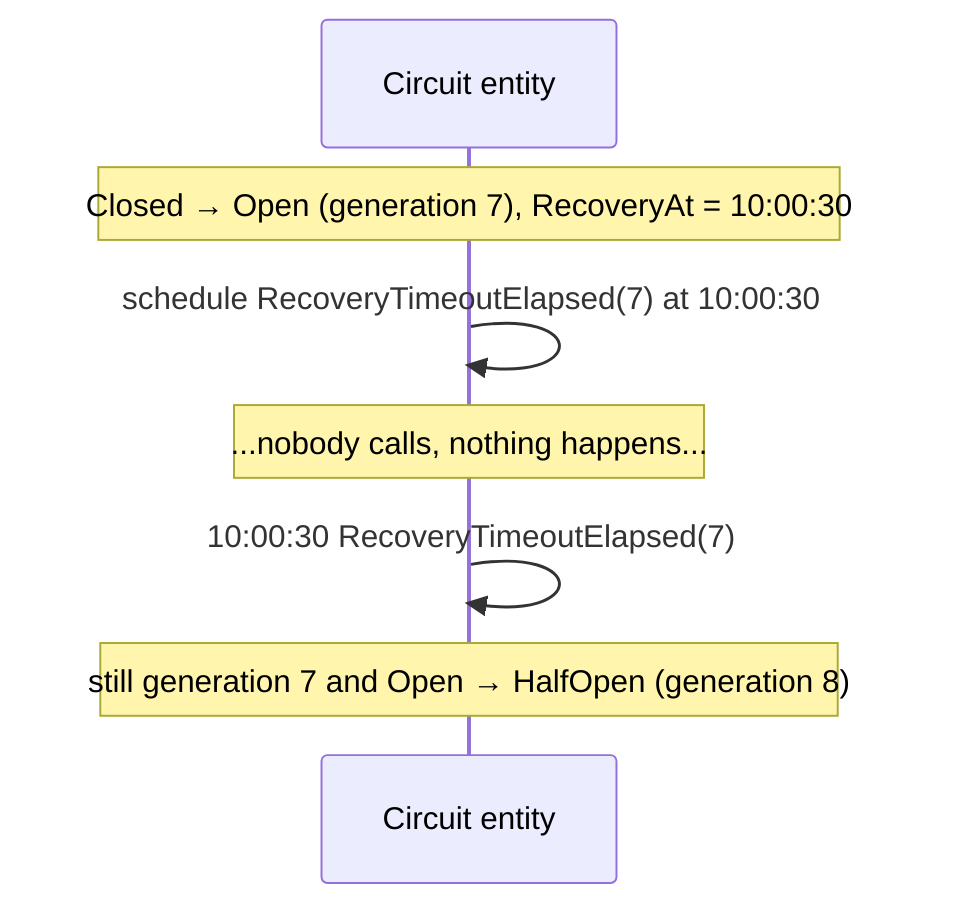

# Recovery timeout

When a circuit opens, it stays open for a recovery timeout. Then it moves to `HalfOpen` and lets a
few [probes](half-open-probes.md) through. If they fail, it opens again — for longer.

```csharp
new CircuitDefinition
{
    // ...
    RecoveryTimeout = TimeSpan.FromSeconds(30),     // the first opening
    MaxRecoveryTimeout = TimeSpan.FromMinutes(10),  // the ceiling
    RecoveryJitter = 0.1,                           // ±10 %
}
```

## Exponential backoff

[Backoff.cs](../src/CircuitBreaker.Core/Backoff.cs):

```text
delay = min(RecoveryTimeout × 2^ConsecutiveReopens, MaxRecoveryTimeout) × (1 ± RecoveryJitter)
```

| Opening | Delay (30 s base, 10 min cap, no jitter) |
|---|---|
| first, from `Closed` | 30 s |
| after 1 failed probe round | 1 min |
| after 2 | 2 min |
| after 3 | 4 min |
| after 4 | 8 min |
| after 5 and more | 10 min |

`ConsecutiveReopens` resets when the circuit closes, so the next outage starts with 30 seconds again.
The test `Every_failed_probe_doubles_the_recovery_timeout_up_to_the_maximum` in
[RecoveryTests.cs](../tests/CircuitBreaker.Core.Tests/RecoveryTests.cs) pins the sequence.

A dependency that is down for an hour gets about twelve probe rounds instead of 120, and each round is
a handful of calls, not a flood.

## Jitter

Circuits for related dependencies often open at the same moment — the same network blip hits them
all. Without jitter they would all probe at the same moment too. The jitter spreads each delay by up
to ±10 %.

The jitter is **deterministic**: a hash of the circuit key and the generation, not a random number.
The same circuit in the same generation always gets the same delay, which keeps the entity safe to
re-execute after a crash and the tests exact, while different circuits and different openings still
spread out.

## How the timeout is enforced

Opening schedules a durable signal to the entity itself at `RecoveryAt`, carrying the generation:



Nothing polls, and nothing waits in a process: the timer survives restarts. If the circuit changed in
between — an operator reset it, or isolated it — the generation no longer matches and the timer is
ignored. See [concurrency.md](concurrency.md#stale-and-duplicate-signals).

Callers also see `RecoveryAt` in their cached state. Once it has passed, a caller asks for a probe
permit instead of refusing locally, even before its cache knows about `HalfOpen`.

## Choosing the numbers

- **Base timeout: how long a typical hiccup lasts.** A pod restart or a failover takes 10–60 seconds;
  30 seconds is a good start. Shorter means more probes against a dependency that is still down.
- **Maximum: how long you can tolerate not noticing a recovery.** With 10 minutes, a dependency that
  comes back may wait up to 10 minutes before traffic resumes. If that is too long for the business,
  lower it — or let an operator reset the circuit when the dependency's owners announce the fix.
- **Isolate instead of a huge maximum.** For a planned outage, an operator isolates the circuit and
  resets it afterwards. Recovery timeouts are for outages nobody announced.
