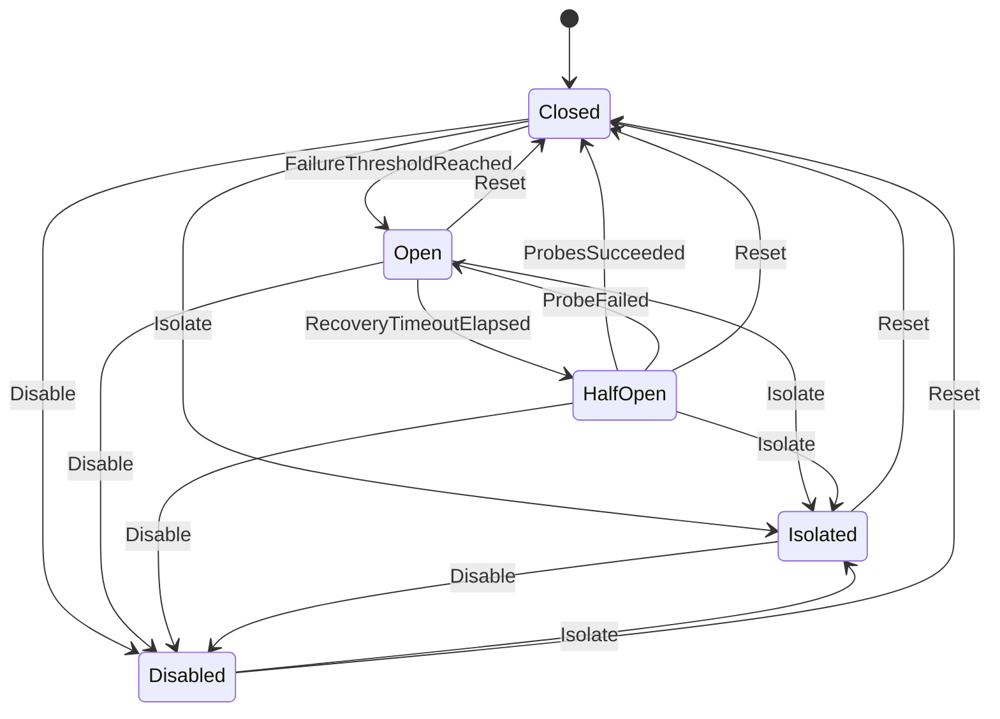

# State machine

A circuit is always in exactly one of five states. Three of them — `Closed`, `Open` and `HalfOpen`
— are driven automatically by outcomes and time. Two — `Isolated` and `Disabled` — are manual
overrides for operators.

This diagram is checked against the code: a test fails if it differs from the table in
[CircuitTransitions.cs](../src/CircuitBreaker.Core/CircuitTransitions.cs).

## The states

| State | Calls | Outcomes | Leaves by |
|---|---|---|---|
| `Closed` | allowed, no extra network call | counted in the [failure window](failure-threshold.md) | threshold reached → `Open` |
| `Open` | refused at once, [fail-fast](fail-fast.md) | recorded, change nothing | [recovery timeout](recovery-timeout.md) → `HalfOpen` |
| `HalfOpen` | only with one of a few [probe permits](half-open-probes.md) | probe results decide | enough successes → `Closed`; a failure → `Open` |
| `Isolated` | refused | recorded, change nothing | operator: `Reset` or `Disable` |
| `Disabled` | allowed | recorded, never open the circuit | operator: `Reset` or `Isolate` |

`Isolated` is the emergency stop: "do not touch this dependency until I say so" — during an
incident, a migration, a restore. `Disabled` is the opposite override: "let everything through" —
when the breaker itself misbehaves, or during maintenance where you prefer errors to pass through.

## The rules

1. **One table.** Every transition is a row in `CircuitTransitions.All`. Anything not in the table is
   not a transition: the engine leaves the state alone. There is no `if` somewhere else that moves a
   circuit.
2. **Every transition increments the generation.** Timers and probe leases carry the generation they
   were created in; when it no longer matches, they are stale and ignored. See
   [concurrency.md](concurrency.md).
3. **Entering a state resets what belongs to the previous one.** Probe leases and the recovery time
   never leak into a state where they mean nothing. Entering `Closed` starts with an empty window and
   no backoff.
4. **Every transition is recorded** with its trigger, reason, time and — for manual actions — actor,
   in the circuit's history (the 20 most recent) and as a structured log event.
5. **Every state can return to `Closed`.** A test walks the table to prove it.

## Manual actions follow from the table

The actions an operator may take in a state are exactly the manual triggers the table allows from
it, plus `Delete`. The breaker computes them and sends them with every snapshot (`allowedActions`);
the [management UI](management-ui.md) shows exactly those buttons and implements no rules of its own.

| State | Allowed actions |
|---|---|
| `Closed` | Isolate, Disable, Delete |
| `Open` | Isolate, Disable, Reset, Delete |
| `HalfOpen` | Isolate, Disable, Reset, Delete |
| `Isolated` | Disable, Reset, Delete |
| `Disabled` | Isolate, Reset, Delete |

## Why a hand-written table, not a state machine library

A library such as Stateless works well, and is a fine choice. A table of sixteen rows is short
enough to read in one glance, can be printed in documentation and checked by tests, and leaves the
entry and exit behaviour in one plain method (`CircuitEngine.Transition`). Choose what your team
reads most easily; keep the transitions in one place either way.

## How it is tested

[StateMachineTests.cs](../tests/CircuitBreaker.Core.Tests/StateMachineTests.cs) runs a seeded random
walk of 5,000 operations — outcomes, timers (some stale), probes, manual actions — and asserts after
every step that:

- every transition that happened is in the table;
- there are never more probe leases than allowed, and none outside `HalfOpen`;
- a recovery time exists exactly while `Open`;
- history and window stay bounded;
- the generation equals the number of transitions.
