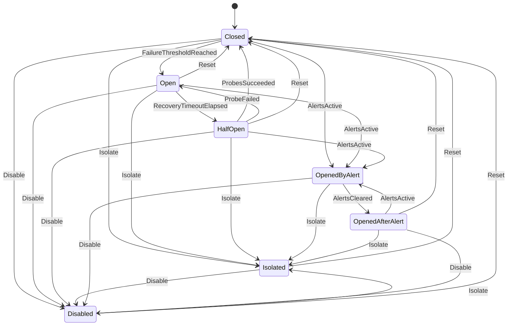

# State machine

A circuit is always in exactly one of seven states. Three of them — `Closed`, `Open` and `HalfOpen`
— are driven automatically by outcomes and time. Two — `Isolated` and `Disabled` — are manual
overrides for operators. Two more — `OpenedByAlert` and `OpenedAfterAlert` — exist only for
circuits that link Azure Monitor alert rules; see [alert-driven-opening.md](alert-driven-opening.md).

This diagram is checked against the code: a test fails if it differs from the table in
[CircuitTransitions.cs](../src/CircuitBreaker.Core/CircuitTransitions.cs).

## The states

| State | Calls | Outcomes | Leaves by |
|---|---|---|---|
| `Closed` | allowed, no extra network call | counted in the [failure window](failure-threshold.md) | threshold reached → `Open` |
| `Open` | refused at once, [fail-fast](fail-fast.md) | recorded, change nothing | [recovery timeout](recovery-timeout.md) → `HalfOpen` |
| `HalfOpen` | only with one of a few [probe permits](half-open-probes.md) | probe results decide | enough successes → `Closed`; a failure → `Open` |
| `Isolated` | refused | recorded, change nothing | operator: `Reset` or `Disable` |
| `Disabled` | allowed | recorded, never open the circuit | operator: `Reset` or `Isolate` |
| `OpenedByAlert` | refused | recorded, change nothing | the alert resolves → `OpenedAfterAlert`; operator: `Isolate` or `Disable` (no `Reset`) |
| `OpenedAfterAlert` | refused | recorded, change nothing | operator: `Reset`, `Isolate` or `Disable`; the alert fires again → `OpenedByAlert` |

`Isolated` is the emergency stop: "do not touch this dependency until I say so" — during an
incident, a migration, a restore. `Disabled` is the opposite override: "let everything through" —
when the breaker itself misbehaves, or during maintenance where you prefer errors to pass through.

`OpenedByAlert` cannot be reset: the alert says the dependency is still wrong, and a reset would be
undone by the next poll a minute later. Close the alert first, or `Disable` the circuit to release
work on purpose. `OpenedAfterAlert` does not close by itself: an alert that resolves says the
symptom is gone, not that the data the stopped work depends on has been repaired. Isolated and
Disabled ignore alerts; they are a person's decision.

## The rules

1. **One table.** Every transition is a row in `CircuitTransitions.All`. Anything not in the table is
   not a transition: the engine leaves the state alone. There is no `if` somewhere else that moves a
   circuit.
2. **Every transition increments the generation.** Timers and probe leases carry the generation they
   were created in; when it no longer matches, they are stale and ignored. See
   [concurrency.md](concurrency.md).
3. **Entering a state resets what belongs to the previous one.** Probe leases and the recovery time
   never leak into a state where they mean nothing. Entering `Closed` starts with an empty window and
   no backoff.
4. **Every transition is recorded** with its trigger, reason, time and — for manual actions — actor,
   in the circuit's history (the 20 most recent) and as a structured log event.
5. **Every state can return to `Closed`.** A test walks the table to prove it.

## Manual actions follow from the table

The actions an operator may take in a state are exactly the manual triggers the table allows from
it, plus `Delete`. The breaker computes them and sends them with every snapshot (`allowedActions`);
the [management UI](management-ui.md) shows exactly those buttons and implements no rules of its own.

| State | Allowed actions |
|---|---|
| `Closed` | Isolate, Disable, Delete |
| `Open` | Isolate, Disable, Reset, Delete |
| `HalfOpen` | Isolate, Disable, Reset, Delete |
| `Isolated` | Disable, Reset, Delete |
| `Disabled` | Isolate, Reset, Delete |
| `OpenedByAlert` | Isolate, Disable, Delete |
| `OpenedAfterAlert` | Isolate, Disable, Reset, Delete |

A refused action — `Reset` while `OpenedByAlert`, for example — returns HTTP 409 with the reason;
the UI does not offer it in the first place.

## States and triggers are append-only

The state and trigger names travel as strings in snapshots, history and stored entity state. A
reader that does not know a value cannot read the message at all: an old client fails on a snapshot
in `OpenedByAlert`, an old entity fails to load state that contains it. So:

- add new values at the end, never rename or remove one;
- deploy every reader (clients, UI) before anything can produce the new value — for alert-driven
  opening that means: release with polling `Off`, then turn it on;
- [EnumContractTests.cs](../tests/CircuitBreaker.Core.Tests/EnumContractTests.cs) pins the existing
  names and their order, so a rename or a value inserted in the middle fails the build.

## Why a hand-written table, not a state machine library

A library such as Stateless works well, and is a fine choice. A table of twenty-six rows is short
enough to read in one glance, can be printed in documentation and checked by tests, and leaves the
entry and exit behaviour in one plain method (`CircuitEngine.Transition`). Choose what your team
reads most easily; keep the transitions in one place either way.

## How it is tested

[StateMachineTests.cs](../tests/CircuitBreaker.Core.Tests/StateMachineTests.cs) runs a seeded random
walk of 5,000 operations — outcomes, timers (some stale), probes, manual actions, alert polls — and asserts after
every step that:

- every transition that happened is in the table;
- there are never more probe leases than allowed, and none outside `HalfOpen`;
- a recovery time exists exactly while `Open`;
- history and window stay bounded;
- the generation equals the number of transitions.
