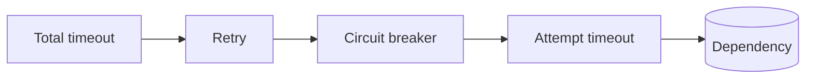

# Timeouts and retries

Timeouts, retries and a circuit breaker each protect against something different, and each can
undo the others when configured carelessly. This page is about making them work together.

## The order



From the outside in:

1. **Total timeout**: how long the *user* is willing to wait, retries included.
2. **Retry**: tries again on transient failures — but never on a refusal by the circuit.
3. **Circuit breaker**: refuses when open; judges *each attempt*.
4. **Attempt timeout**: how long one attempt may take. It lives inside the circuit, so a slow call is
   recorded as a `Timeout` failure.

Retries outside the circuit means every attempt is an outcome: three failing attempts are three
failures, which is what they are. Retries inside the circuit would hide failures from it.

## In code

The client's `HttpClient` handler and a retry from `Microsoft.Extensions.Http.Resilience`:

```csharp
var payments = builder.Services.AddHttpClient("payments", c => c.BaseAddress = new Uri("https://payments.example.com/"));

// Outer: retry transient failures, but not refusals.
payments.AddResilienceHandler("retry", pipeline => pipeline
    .AddTimeout(TimeSpan.FromSeconds(30))                      // total
    .AddRetry(new HttpRetryStrategyOptions
    {
        MaxRetryAttempts = 2,
        BackoffType = DelayBackoffType.Exponential,
        UseJitter = true,
        ShouldHandle = args => ValueTask.FromResult(args.Outcome switch
        {
            { Exception: BrokenCircuitException } => false,    // the circuit said no: do not hammer it
            { Exception: not null } => true,
            { Result: { } response } => (int)response.StatusCode >= 500 || (int)response.StatusCode == 429,
            _ => false,
        }),
    }));

// Inner: the shared circuit, with its attempt timeout.
payments.AddCircuitBreaker("payments-api");
```

Handlers added first are outermost. [RetryCompositionTests](../tests/CircuitBreaker.Client.Tests/ReportingTests.cs)
verifies both properties: each retry attempt is reported as its own outcome, and an open circuit is
refused once, with no retries and no call to the dependency.

## Do not use `AddStandardResilienceHandler` unchanged

The standard handler includes its own, in-process circuit breaker and its own attempt timeout.
Either use the individual strategies as above, or keep the standard handler and remove its breaker:
two breakers with different opinions about the same dependency make behaviour hard to predict.

A local breaker can still be useful *in addition*: it reacts within one process in milliseconds,
while the shared circuit needs up to `ReportInterval + SnapshotTtl` to propagate. If you keep both,
make the local one less sensitive (higher threshold), so the shared circuit does the deciding.

## Avoiding retry storms

A retry storm happens when every layer retries: the client retries three times, the API it calls
retries three times, the database driver retries three times — 27 attempts for one user action, all
landing on a dependency that is already struggling.

- **Retry in one layer only**, the one closest to the user that can still give a useful answer.
- **Never retry a refusal.** `BrokenCircuitException` means "not now"; the circuit already knows.
- **Back off with jitter**, so callers that failed together do not retry together.
- **Count every attempt.** That is why the circuit sits inside the retry: a storm opens the circuit
  quickly, and the open circuit ends the storm.

## Making timeouts and the breaker agree

| Setting | Rule | Default |
|---|---|---|
| `AttemptTimeout` (client) | just above the dependency's normal worst-case latency | 10 s |
| `ProbeTimeout` (circuit) | above `AttemptTimeout`, so a slow successful probe is not cut off | 30 s |
| total timeout (your pipeline) | ≥ attempts × `AttemptTimeout` + backoff, or retries never happen | yours |
| `FailureWindow` (circuit) | long enough to contain `FailureThreshold` attempts at your volume | 60 s |
| `BreakerCallTimeout` (client) | short: calls to the breaker are on your request path | 3 s |
| `Api:ProbeWaitTimeout` (Function) | below `BreakerCallTimeout`, so the breaker says "denied" before the caller gives up | 2 s |

A too generous attempt timeout delays detection: with a 60-second timeout and a threshold of 5, a
hanging dependency needs five minutes of hung calls before the circuit opens — unless calls run in
parallel, in which case your threads are exhausted first.

## Queue consumers

For messages, the retry policy is the broker's redelivery (`MaxDeliveryCount`). Opening the circuit
should stop deliveries instead of burning through them: use a [switch](switches.md) so the
subscription stops receiving while the circuit is open, and messages wait instead of being
dead-lettered.
